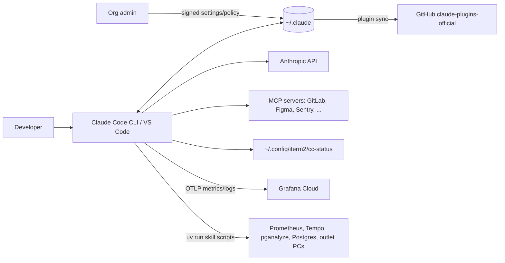

# High-Level Diagram

## Diagram

## Components

| Component | Description |
|---|---|
| `~/.claude` | Config + state store ([overview](../overview/description.md)) |
| MCP servers | Several need auth (listed in `mcp-needs-auth-cache.json`) |
| Grafana Cloud | Target of OTLP export from managed settings |

## Communication Paths

| From → To | Protocol |
|---|---|
| Claude Code → Grafana | OTLP http/protobuf, 60 s interval |
| Claude Code → IDE | WebSocket (`ide/<n>.lock`) |
| Claude Code → hooks | local process exec |
| Marketplace → plugins | git/GitHub fetch |

## Related Documentation

- [System overview](system-overview.md)
- [Telemetry](../observability/telemetry.md)
