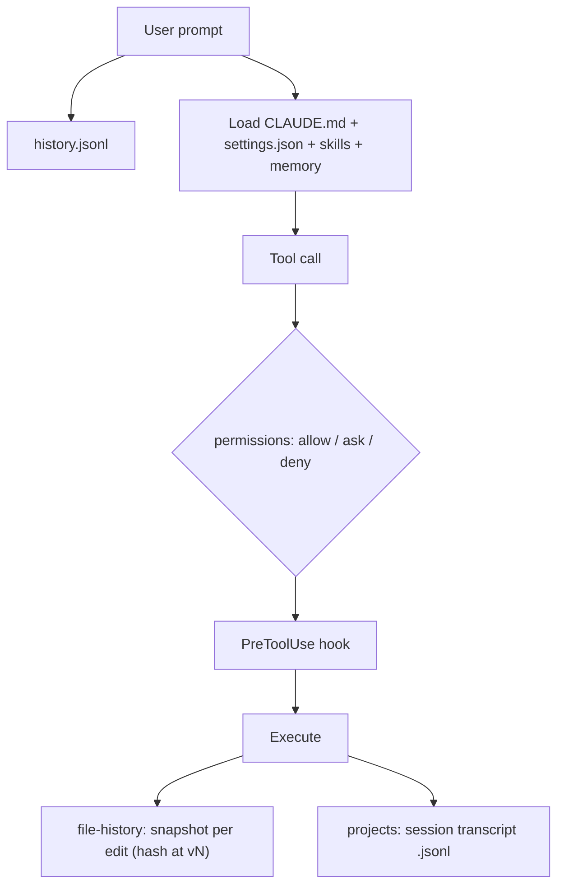

# Low-Level Diagram

## Modules

| Module | Folder |
|---|---|
| Skills | `skills/<name>/{SKILL.md, instructions.md, scripts/}` |
| Plugin store | `plugins/{cache,marketplaces,store,synced,.trash}` |
| Project state | `projects/<encoded-cwd>/{*.jsonl, <session>/, memory/}` |

## Internal components

- **Skill layering** (from [CLAUDE.md](../domain/configuration/claude-md.md)): CLI entry `scripts/<name>.py` → private helpers `scripts/_*.py` → shared infra `../../shared/` (referenced; not present at the moment).
- **Workers / Controllers / Repositories / Event handlers**: not applicable.

## Important dependencies

`uv`, Python stdlib/PyYAML, per-skill HTTP clients (`_prometheus.py`, `_tempo.py`, `_pganalyze.py`).

## Internal data flow

Config flows inward (files → Claude Code); state flows outward (Claude Code → `projects/`, `file-history/`, `telemetry/`).

## Related Documentation

- [Skills system](../domain/business-logic/skills-system.md)
- [Sessions and memory](../domain/business-logic/sessions-and-memory.md)
